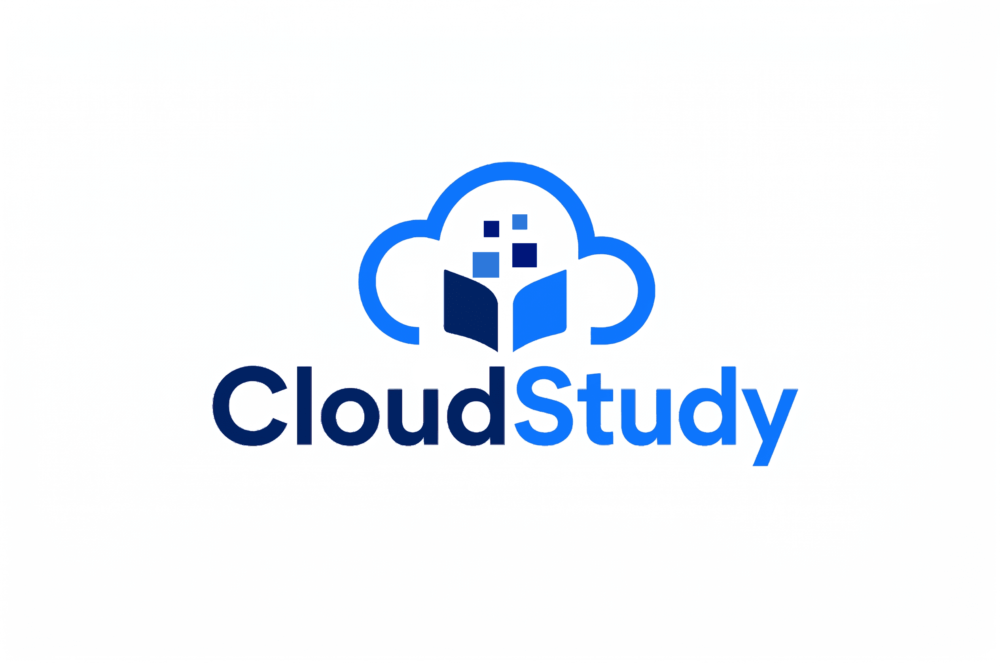

**English edition** · [Portuguese edition](https://github.com/Thiago-code-lab/aws-certified-cloud-practitioner-brasil/tree/main) · [Editorial audit](docs/english-edition/README.md)

<p align="center">

</p>

*Original banner artwork is preserved. English text: “A complete, free guide to AWS fundamentals. Theory in practice · Hands-on labs · Flashcards · Maps and summaries · Browsable portal.” “Free” refers to these open-source study materials.*


<p align="center">
<a href="https://www.cloudstudy.com.br/">

  </a>
</p>

<p align="center">
<strong>Study for AWS Cloud Practitioner (CLF-C02) with theory, flashcards, cheatsheets, questions with answer explanations, and hands-on labs.</strong>
</p>

<p align="center">
<strong>CloudStudy is available. Explore the platform and continue your AWS learning journey.</strong>
</p>

<p align="center">
<a href="https://app.cloudstudy.com.br/">

  </a>
</p>

<div align="center">
<a href="https://www.udemy.com/course/engenharia-de-dados-na-aws-do-zero-aos-projetos-reais/?referralCode=E28670B9116BA68E08A9">

  </a>
    
<a href="https://chat.whatsapp.com/Lsuexbkt1oELAGX8nCH2La?mode=gi_t">

  </a>
</div>

<p align="center">

</p>

<div align="center">

<a href="https://www.cloudstudy.com.br/">

</a>

<a href="https://www.instagram.com/cloudstudy.ai/">

</a>

</div>

<h1 align="center">AWS Certified Cloud Practitioner (CLF-C02) | English Edition</h1>
<p align="center">
Free open-source AWS fundamentals, guided study paths, and reviewed practice questions in American English.
</p>

<p align="center">


</p>

<p align="center">


</p>

---

## Overview

This free, open-source learning path covers AWS fundamentals through 18 modules, hands-on labs, flashcards, cheatsheets, and practice questions with explanations. It is designed for learners preparing for AWS Certified Cloud Practitioner (CLF-C02), including those new to cloud computing.

| Block | What do you find |
|---|---|
| Fundamentals | Cloud concepts, regions, service models and certification basis |
| Central services | EC2, S3, networking, databases, security, and core operations |
| Review | Short practice exams, glossary and retention aids |
| Support | Notes, cheatsheets, flashcards, labs, and study flow docs |

## Study Roadmap

1. Modules 01 to 05: cloud fundamentals, security and network.
2. Modules 06 to 10: data services, storage and costs.
3. Modules 11 to 15: context of adoption, architecture and innovation.
4. Modules 16 to 18: consolidation, review and next steps.

## Recommended study workflow

1. Fundamentals: [Module 01](./01-Introduction-to-Cloud-Computing/README.md) + [domain review](./quick-review/fundamentals.md)
2. Security: [Module 03](./03-Security-and-Compliance/README.md) + [domain revision](./quick-review/security.md)
3. Storage: [Module 04](./04-Amazon-S3/README.md) + [domain revision](./quick-review/storage.md)
4. Costs: [Module 10](./10-Pricing-and-Support/README.md) + [domain review](./quick-review/costs.md)
5. Final review: [quick-review](./quick-review/README.md) + [flashcards](./flashcards/README.md)

## Review Ecosystem

| Layer | Objective | Link |
|---|---|---|
| Review by module | Recognize exam clues in the module context | [Modules](#modules) |
| Review by domain | Fix recurring errors without rereading everything | [quick-review](./quick-review/README.md) |
| Short notes | Reinforce essential concepts by theme | [notes](./notes/README.md) |
| Flashcards | Active memorization with hidden answers | [flashcards](./flashcards/README.md) |
| Practice Exams | Validate understanding in questions with answer explanations | [practice exams](./16-Practice-Exams-and-Questions/README.md) |

## Modules

| # | Theme | Link |
|---|---|---|
| 01 | Introduction to Cloud Computing | [Open](./01-Introduction-to-Cloud-Computing/README.md) |
| 02 | Amazon EC2 | [Open](./02-Amazon-EC2/README.md) |
| 03 | Security and Compliance | [Open](./03-Security-and-Compliance/README.md) |
| 04 | Amazon S3 | [Open](./04-Amazon-S3/README.md) |
| 05 | Networking and Connectivity | [Open](./05-Networking-and-Connectivity/README.md) |
| 06 | Databases | [Open](./06-Databases/README.md) |
| 07 | Serverless Computing | [Open](./07-Serverless-Computing/README.md) |
| 08 | Storage | [Open](./08-Storage/README.md) |
| 09 | Monitoring and Governance | [Open](./09-Monitoring-and-Governance/README.md) |
| 10 | Pricing and Support | [Open](./10-Pricing-and-Support/README.md) |
| 11 | Migration and Innovation | [Open](./11-Migration-and-Innovation/README.md) |
| 12 | Cloud Adoption Framework | [Open](./12-CAF-Cloud-Adoption-Framework/README.md) |
| 13 | Well-Architected Framework | [Open](./13-Well-Architected-Framework/README.md) |
| 14 | AI and Machine Learning | [Open](./14-Artificial-Intelligence-and-ML/README.md) |
| 15 | Developer Services | [Open](./15-Developer-Services/README.md) |
| 16 | Practice Exams and Questions | [Open](./16-Practice-Exams-and-Questions/README.md) |
| 17 | AWS Glossary | [Open](./17-Glossary/README.md) |
| 18 | Resources and Links | [Open](./18-Resources-and-Links/README.md) |

## Next AWS Tracks

- **AWS Solutions Architect Associate (SAA-C03):** evolution for architectural decisions, scalability and solution design.
https://github.com/Thiago-code-lab/aws-certified-solutions-architect-associate-brasil/tree/saa-c03-english

- **AWS AI Practitioner (AIF-C01):** Add-on track for generative AI fundamentals and AI services on AWS.
https://github.com/Thiago-code-lab/aws-certified-ai-practitioner-brasil

## How to use this repository

Browse the module table on GitHub and open each module’s lesson list. For offline reading, clone the English branch:

```sh
git clone --branch clf-c02-english https://github.com/Thiago-code-lab/aws-certified-cloud-practitioner-brasil.git
cd aws-certified-cloud-practitioner-brasil
```

Read the lessons, answer questions before expanding the explanations, and keep an error log. Use [flashcards](flashcards/README.md) for active recall, [cheatsheets](cheatsheets/README.md) for comparisons, and [labs](labs/README.md) for hands-on practice. The [study guides](docs/README.md), [notes](notes/README.md), [glossary](17-Glossary/README.md), and [diagrams](diagrams/README.md) support review. Markdown study materials require no application setup.

## Contributions

See the [contribution guide](.github/CONTRIBUTING.md), [code of conduct](.github/CODE_OF_CONDUCT.md), and [issue templates](.github/ISSUE_TEMPLATE/bug_report.md). Submit English documentation improvements against `clf-c02-english`.

## License

Available under the [MIT License](LICENSE).

---

## Official CLF-C02 domains

The 18 modules are a study sequence, not official exam domains.

| Official domain | Weight |
|---|---:|
| 1. Cloud Concepts | 24% |
| 2. Security and Compliance | 30% |
| 3. Cloud Technology and Services | 34% |
| 4. Billing, Pricing, and Support | 12% |

The [official exam guide](https://docs.aws.amazon.com/aws-certification/latest/cloud-practitioner-02/cloud-practitioner-02.html) and [revision history](https://docs.aws.amazon.com/aws-certification/latest/cloud-practitioner-02/clf-02-revisions.html) were checked on November 16, 2026 (version 1.3, October 29, 2026).

There are 44 multiple-choice study questions: 40 in module 16 and four in Quick Review. The short practice exam contains 10 questions. Flashcards and open-response checks provide additional practice. These materials are free under the MIT license. CloudStudy platform features may have separate terms; visit [CloudStudy](https://app.cloudstudy.com.br/) for current offerings.


## ☁️ Follow CloudStudy

CloudStudy is available to help learners study AWS. Explore the platform at https://app.cloudstudy.com.br/. These open-source GitHub study materials are free; platform features may have separate terms.

Follow CloudStudy to keep up with new materials, updates and content about AWS certifications:

- Instagram: official badge at the top of this README
- LinkedIn: https://www.linkedin.com/company/cloudstudy-ai/

---
