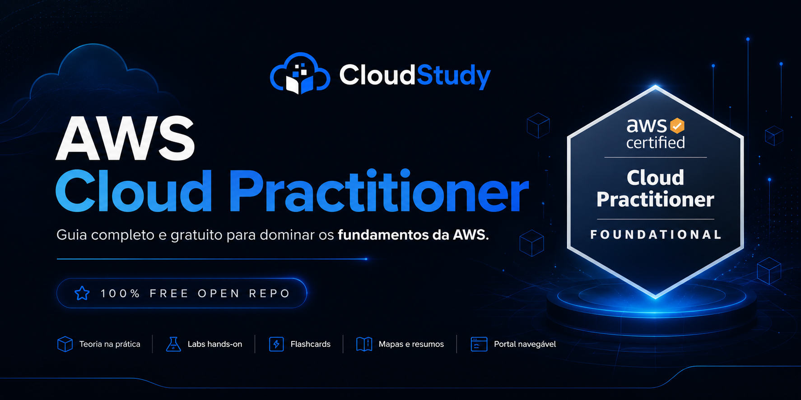

<strong>Study for AWS Cloud Practitioner (CLF-C02) with theory, flashcards, cheatsheets, commented questions, and hands-on labs.</strong>

<strong>Join the CloudStudy waitlist and receive early access to the platform.</strong>

    

<h1 align="center">AWS Cloud Practitioner (CLF-C02) | Brazil</h1>

Open source base in PT-BR for AWS fundamentals with premium navigation and evolution trail.

---

## Overview

This repository organizes AWS fundamentals into objective modules, focusing on progressive reading, quick review, and initial practice. The public proposal prioritizes clarity and consistency for those starting out in the cloud.

| Block | What do you find |
|---|---|
| Fundamentals | Cloud concepts, regions, service models and certification basis |
| Central services | EC2, S3, Network, Banking, Security & Core Operations |
| Review | Short simulations, glossary and fixing material |
| Support | Notes, cheatsheets, flashcards, labs, and study flow docs |

## Study Roadmap

1. Modules 01 to 05: cloud base, security and network.
2. Modules 06 to 10: data services, storage and costs.
3. Modules 11 to 15: context of adoption, architecture and innovation.
4. Modules 16 to 18: consolidation, review and next steps.

## Recommended Revision Route

1. Fundamentals: [Module 01](./01-Introduction-to-Cloud-Computing/README.md) + [domain review](./quick-review/fundamentals.md)
2. Security: [Module 03](./03-Security-and-Compliance/README.md) + [domain revision](./quick-review/security.md)
3. Storage: [Module 04](./04-Amazon-S3/README.md) + [domain revision](./quick-review/storage.md)
4. Costs: [Module 10](./10-Pricing-and-Support/README.md) + [domain review](./quick-review/costs.md)
5. Short Consolidation: [quick-review](./quick-review/README.md) + [flashcards](./flashcards/README.md)

## Review Ecosystem

| Layer | Objective | Link |
|---|---|---|
| Review by module | Fix proof signs in the module context | [Modules](#módulos) |
| Review by domain | Fix recurring errors without rereading everything | [quick-review](./quick-review/README.md) |
| Short notes | Reinforce essential concepts by theme | [notes](./notes/README.md) |
| Flashcards | Active memorization with hidden answers | [flashcards](./flashcards/README.md) |
| Simulations | Validate understanding in commented questions | [simulated](./16-Practice-Exams-and-Questions/README.md) |

## Modules

| # | Theme | Link |
|---|---|---|
| 01 | Introduction to Cloud Computing | [Open](./01-Introduction-to-Cloud-Computing/README.md) |
| 02 | Amazon EC2 | [Open](./02-Amazon-EC2/README.md) |
| 03 | Security and Compliance | [Open](./03-Security-and-Compliance/README.md) |
| 04 | Amazon S3 | [Open](./04-Amazon-S3/README.md) |
| 05 | Networks and Connectivity | [Open](./05-Networking-and-Connectivity/README.md) |
| 06 | Database | [Open](./06-Databases/README.md) |
| 07 | Serverless Computing | [Open](./07-Serverless-Computing/README.md) |
| 08 | Storage | [Open](./08-Storage/README.md) |
| 09 | Monitoring and Governance | [Open](./09-Monitoring-and-Governance/README.md) |
| 10 | Pricing and Support | [Open](./10-Pricing-and-Support/README.md) |
| 11 | Migration and Innovation | [Open](./11-Migration-and-Innovation/README.md) |
| 12 | Cloud Adoption Framework | [Open](./12-CAF-Cloud-Adoption-Framework/README.md) |
| 13 | Well-Architected Framework | [Open](./13-Well-Architected-Framework/README.md) |
| 14 | AI and Machine Learning | [Open](./14-Artificial-Intelligence-and-ML/README.md) |
| 15 | Developer Services | [Open](./15-Developer-Services/README.md) |
| 16 | Simulations and Questions | [Open](./16-Practice-Exams-and-Questions/README.md) |
| 17 | AWS Glossary | [Open](./17-Glossary/README.md) |
| 18 | Resources and Links | [Open](./18-Resources-and-Links/README.md) |

## Next AWS Tracks

- **AWS Solutions Architect Associate (SAA-C03):** evolution for architectural decisions, scalability and solution design.
https://github.com/Thiago-code-lab/aws-certified-solutions-architect-associate-brasil

- **AWS AI Practitioner (AIF-C01):** Add-on track for generative AI fundamentals and AI services on AWS.
https://github.com/Thiago-code-lab/aws-certified-ai-practitioner-brasil

## License

MIT

---

## ☁️ Follow CloudStudy

CloudStudy is available to help learners study AWS. Explore the platform at https://app.cloudstudy.com.br/. These open-source GitHub study materials are free; platform features may have separate terms.

Follow CloudStudy to keep up with new materials, updates and content about AWS certifications:

- Instagram: official badge at the top of this README
- LinkedIn: https://www.linkedin.com/company/cloudstudy-ai/

---
